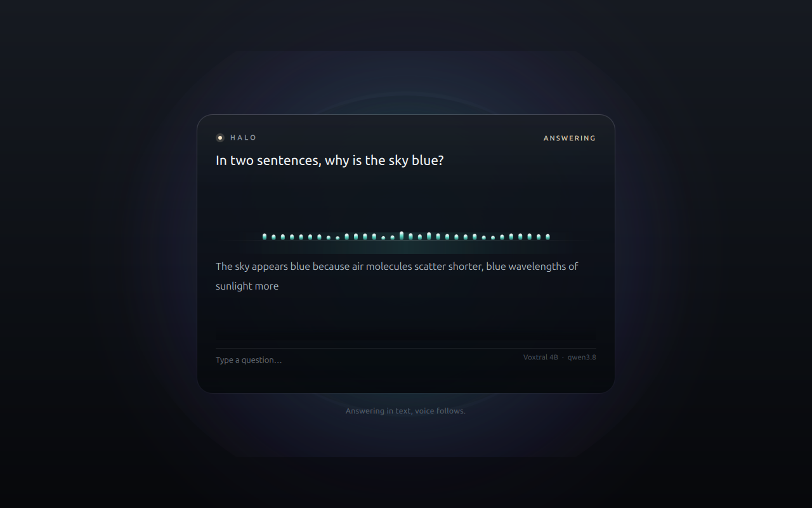
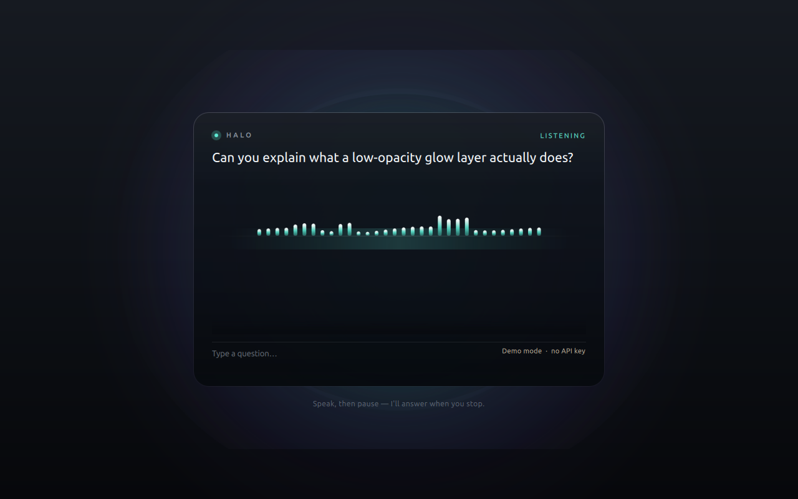
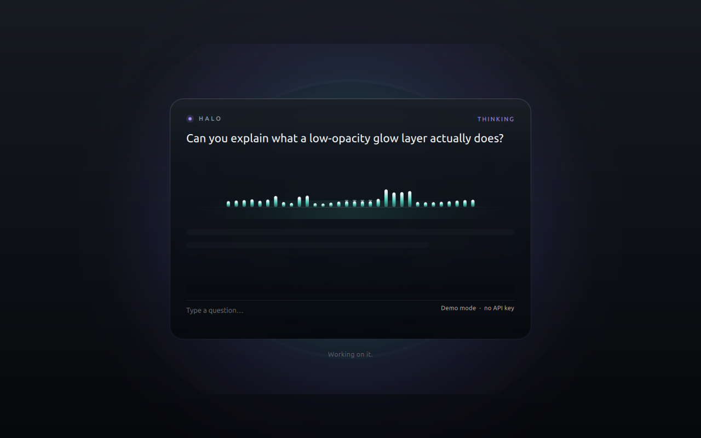
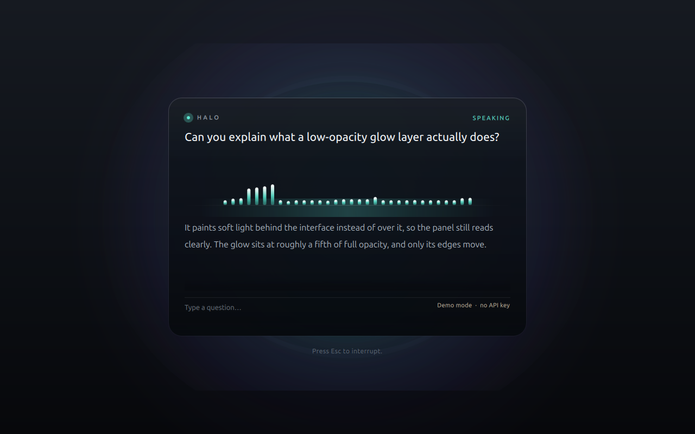

# Halo — a quiet voice assistant for the desktop

Press **Ctrl + Space** anywhere and a low-opacity glow opens in the middle of the
screen. Speak. Halo transcribes you with **Voxtral Mini 4B Realtime running
locally on your GPU**, answers, speaks the answer back with a local voice, and
shows the text while a glossy audio bar moves with the sound.

Everything after the keystroke is local: the speech model, the language model
and the voice. No account, no API key, no audio leaving the machine.



*Above: a real run — the WAV was spoken into the sidecar, Voxtral produced that
transcript, and the local model wrote the answer as it streamed in.*

| Listening | Thinking | Speaking |
| --- | --- | --- |
|  |  |  |

*These three are the scripted `--demo` states, captured without a microphone;
the panel says so in the corner.*

---

## What is where

```
halo/
├── src/                    Qt 6 / QML application (C++)
│   ├── AppController       the turn state machine and the demo timeline
│   ├── AudioCapture        16 kHz mono microphone capture, local VAD
│   ├── AudioPlayer         WAV playback + spectrum at the exact play head
│   ├── SpectrumModel       32 log-spaced bands (small FFT) for the bar
│   ├── GlobalHotkey        X11 Ctrl+Space grab (xcb)
│   ├── LocalAsrClient      websocket client for the local Voxtral sidecar
│   ├── OllamaClient        local answers (streaming NDJSON)
│   ├── PiperTts            local speech synthesis
│   ├── MistralClient       optional cloud mode (Voxtral API + Voxtral TTS)
│   ├── WsClient            minimal RFC 6455 client on QTcpSocket/QSslSocket
│   └── WavCodec            WAV read/write
├── qml/                    Main.qml · SpeakingBar.qml · Theme.qml
├── python/asr_server.py    the local Voxtral realtime transcription server
├── scripts/                setup · build · start-asr · fetch-model · fetch-voice
└── models/                 downloaded weights (git-ignored)
```

## Requirements

- **Qt 6.6 or newer** (built and tested with Qt 6.10.2) with Qt Quick,
  Qt Multimedia and Qt Network.
- **A GPU with ~12 GB free VRAM** for the 4B speech model plus whatever the
  local language model needs. This machine runs the 3090 at 22/24 GB with the
  speech model resident and `qwen3.8:27b` partially offloaded to the CPU —
  works, at roughly 12 tokens/s. A 3–8 B model stays entirely in VRAM and is
  faster; `ministral-3:3b` from this Ollama install returns empty content, so it
  is not the default here.
- **Python 3.12** and [uv](https://docs.astral.sh/uv/) for the speech sidecar.
- **Ollama** running locally for the answers (`ollama serve`).
- Linux/X11 for the global hotkey. On Wayland the shortcut works when the
  overlay has focus; binding it system-wide needs your compositor's own
  shortcut settings (point it at `halo --toggle`).

## Install

```bash
cd ~/halo

# 1. Qt app
./scripts/build.sh

# 2. local speech model + voice (about 9 GB of weights)
./scripts/setup.sh

# 3. a local language model for the answers
ollama pull qwen3.8:27b
```

## Run

```bash
./scripts/start-asr.sh      # local Voxtral, stays resident on the GPU
ollama serve                # if it is not already running
./build/halo                # then press Ctrl + Space
```

The first launch of the sidecar loads ~9 GB of weights: it prints
`model ready` and `serving` when the websocket is accepting audio. The overlay
shows "loading the local voice model" if you press the shortcut too early.

Useful flags:

```bash
./build/halo --show                 # open immediately (no hotkey needed)
./build/halo --demo                 # scripted demo, no model required
./build/halo --ask "your question"  # smoke-test the answer + voice path
./build/halo --capture shots        # write a PNG for every state change
./build/halo --feed question.wav    # stream a 16 kHz mono WAV as the microphone
./build/halo --no-hotkey            # don't grab Ctrl+Space
```

## Using it

1. **Ctrl + Space** opens the overlay and starts listening. If that combination
   belongs to something else (IBus uses it for the input-method switch by
   default), Halo falls back to **Ctrl + Alt + Space**, then Ctrl + Shift +
   Space, then Super + Space, and the hint under the panel names the one it
   got. Pin it with `hotkey=ctrl+alt+space` in the config.
2. Speak. The live transcript appears while you talk; the bar follows your
   voice. Pause for about a second and Halo takes the turn.
3. The answer streams in as text and is spoken sentence by sentence. The bar
   switches to the spectrum of the synthesised voice.
4. When the answer finishes, Halo listens again — keep the conversation going.
5. **Esc** closes the overlay. **Ctrl + Space** toggles it. While speaking,
   **Esc** interrupts.

You can also type a question into the line at the bottom of the panel at any
time, which is the keyboard path for the whole feature (and the only path when
no microphone is present).

## The local model

The speech model is
[`mistralai/Voxtral-Mini-4B-Realtime-2602`](https://huggingface.co/mistralai/Voxtral-Mini-4B-Realtime-2602)
(4B parameters, BF16, Apache-2.0), loaded with Transformers 5.x
(`VoxtralRealtimeForConditionalGeneration`).

`python/asr_server.py` serves it over a tiny websocket protocol on
`ws://127.0.0.1:8765`:

| Direction | Message |
| --- | --- |
| client → server | `{"type":"start"}`, binary PCM frames (16 kHz mono s16le), `{"type":"stop"}` |
| server → client | `{"type":"ready"}`, `{"type":"status"}`, `{"type":"partial","text"}`, `{"type":"final","text"}` |

While audio flows, the server re-transcribes the current utterance every few
hundred milliseconds and sends the best text so far as `partial` (replace, do
not append). On `stop` it runs one final pass over the whole utterance. This
keeps the client protocol trivial and gives live text without a bespoke
streaming decoder; the 3090 transcribes a five second utterance well inside
the speaking pause.

The transcription delay, context bias and language tuning of the hosted API are
not used here — the model's own config (`tekken.json`, 480 ms) applies.

## The rest of the pipeline

| Stage | Local default | Alternative |
| --- | --- | --- |
| Transcription | `python/asr_server.py` + Voxtral 4B | Mistral realtime websocket |
| Answer | Ollama `qwen3.8:27b` (or any chat model) | Mistral chat completions |
| Voice | Piper `en_US-amy-medium` | Voxtral TTS |
| Capture | Qt Multimedia, 16 kHz mono | — |

Set these in `~/.config/Halo/Halo.conf` (plain INI, created on first change):

```ini
[General]
apiKey=                 ; only for the cloud alternatives
asr=local               ; local | mistral
asrEndpoint=ws://127.0.0.1:8765
llm=ollama              ; ollama | mistral
ollamaUrl=http://127.0.0.1:11434
ollamaModel=qwen3.8:27b
tts=piper               ; piper | mistral | none
piperBin=/home/ayoub/halo/.venv/bin/piper
piperVoice=/home/ayoub/halo/models/piper/en_US-amy-medium.onnx
language=en
continuous=true         ; listen again after each answer
reducedMotion=false
apiKey=                 ; MISTRAL_API_KEY also works for the cloud modes
```

## Design notes

- **The glow is a real layer, not a shadow.** A radial-gradient image is
  generated once at start-up (teal core, violet halo) and scaled with the input
  level, so it costs one textured quad per frame.
- **The bar is the spectrum.** `AudioPlayer` reports the exact play head every
  33 ms and the samples that just became audible are transformed with a 512-bin
  FFT into 32 log-spaced bands. The same model is fed by the microphone while
  listening, so the bar is always showing the sound you are hearing.
- **The glass is three layers**: an outer rim gradient, a dark body gradient and
  a top sheen. No blur effects, so it renders identically on software and GPU
  rasterisers.
- **Type scale** is a 16 px base with a minor third (1.2) — 13 / 16 / 21 px —
  and colour roles live in `qml/Theme.qml`.
- **Motion** stays under 400 ms, uses deceleration on entry, and is disabled by
  `reducedMotion` (`HALO_REDUCED_MOTION=1` also works). The bar falls back to a
  static level when motion is reduced.
- **Accessibility**: everything is reachable from the keyboard, Esc always
  closes, focus is visible, the typed path covers the no-microphone case, and
  the demo mode is labelled as such in the panel.

## Verifying the installation

Two tools do the round trip without a microphone:

```bash
# the socket protocol, against the real model
./.venv/bin/python python/selftest_asr.py question.wav      # needs start-asr.sh running

# the whole chain: WAV -> sidecar -> model -> answer -> voice
./build/halo --feed question.wav
```

`scripts/verify-local.sh` waits for the weights, starts the sidecar, speaks a
question into it and prints what the model heard. `python/asr_server.py --stub`
skips the weights entirely and answers with fixed text, which is handy when
working on the UI.

## Troubleshooting

| Symptom | Fix |
| --- | --- |
| "The shortcut is already grabbed" | Another app owns it — usually IBus. Halo falls back automatically; the hint under the panel shows the working combination. |
| Answers come back empty | A reasoning model used all of its budget on hidden thinking. Halo sends `think: false`; if the model still returns nothing (some GGUFs are broken), switch `ollamaModel`. |
| Overlay renders as a black rectangle | Your X session has no compositing manager. Transparency needs one (picom, KWin, Mutter…). |
| "Local voice model: connection refused" | Start `./scripts/start-asr.sh`. |
| First answer is slow | The model is still loading, or Ollama is loading its weights. |
| No sound | Check `piperBin` / `piperVoice` exist and that a default audio output is present. The text answer still works. |
| Garbled first partial | The re-transcription window needs ~1 s of audio before it is meaningful. |

## Licence

Apache-2.0, matching the Voxtral model. The Piper voice is CC-BY 4.0 from the
`rhasspy/piper-voices` collection.
